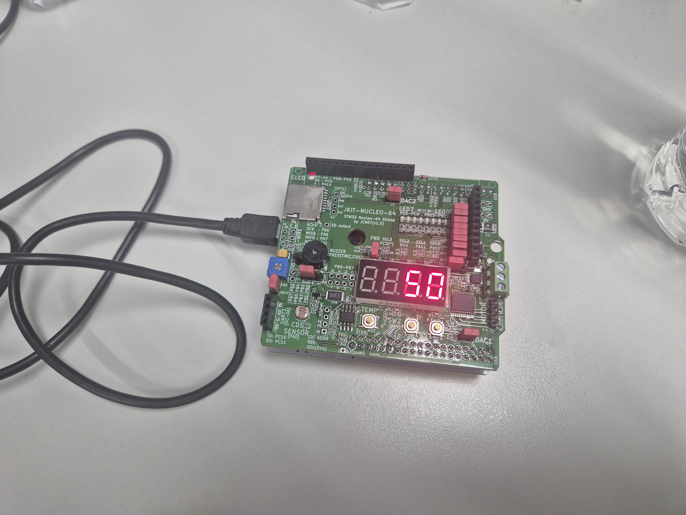

# LAB_GPIO_7segment

**Date:** 2026-09-22

**Author/Partner:** Yeonhu Kim

**Demo Video:** Youtube link


## Introduction

In this lab, you are required to create a simple program to control a 7-segment display to show a decimal number (0\~9) that increases by pressing a push-button.

You must submit

* LAB Report (\*.pdf)
* Zip source files(lab\*\*\*.c, ecRCC2.h, ecGPIO2.h etc...).
  * Only the source files. Do not submit project files

**Requirement**

**Hardware**

* MCU
  * NUCLEO-F411RE
* Actuator/Sensor/Others:
  * eval board

**Software**

* PlatformIO, CMSIS, EC\_HAL library

### Exercise

Fill in the table

| **Port/Pin**    | **Description**              | **Register setting**                      |
| --------------- | ---------------------------- | ----------------------------------------- |
| Port B Pin 5    | Clear Pin5 mode              | GPIOB->MODER &=\~(3<<(5*2))              |
| Port B Pin 5    | Set Pin5 mode = Output       | GPIOB->MODER \|= 1<<(5*2)
| Port B Pin 6    | Clear Pin6 mode              | GPIOB->MODER &=~(3<<(6*2))                |    
| Port B Pin 6    | Set Pin6 mode = Output       | GPIOB->MODER \|= 1<<(6*2)  |
| Port B Pin Y    | Clear PinY mode              | GPIOB->MODER &=\~(3<<(Y*2))   |
| Port B Pin Y    | Set PinY mode = Output       | GPIOB->MODER \|=1<<(Y*2)  |
| Port B Pin 5\~9 | Clear Pin5\~9 mode           | GPIOB->MODER &=\~(1023<<(5*2))  |
|                 | Set Pin5\~9 mode = Output    | GPIOB->MODER \|=1023<<(5*2)  |
| Port X Pin Y    | Clear Pin Y mode             | GPIOX->MODER &=~(3<<(Y*2))   |
|                 | Set Pin Y mode = Output      | GPIOX->MODER \|=1<<(Y*2)  |
| Port B Pin5     | Set Pin5 otype=push-pull     | GPIOB->OTYPER |=0<<5   |
| Port B PinY     | Set PinY otype=push-pull     | GPIOB-> OTYPER =0<<Y  |
| Port B Pin5     | Set Pin5 ospeed=Fast         | GPIOB->OSPEEDR =2<<(5*2)  |
| Port B PinY     | Set PinY ospeed=Fast         | GPIOB-> OSPEEDR =2<<(Y*2)_ |
| Port B Pin 5    | Set Pin5 PUPD=no pullup/down | GPIOB->PUPDR =0<<(5*2)   |
| Port B Pin Y    | Set PinY PUPD=no pullup/down | GPIOB-> PUPDR =0<<(5*2)  |

***


## Problem 1. Library for 7-segment display on JKIT Board

#### Problem

There are four 7-Segment Displays on JKIT board.

* You need to select which one to use.
* There is no BCD decoder
* JKIT - Nucleo 64: [link](https://www.devicemart.co.kr/goods/view?no=14123215\&srsltid=AfmBOooT3zgaxGXZ_q0fvy4uZxHesTbwpqNprE6P3YXMk9V0EGoGrhLM)

<figure><figcaption></figcaption></figure>

Complete the required functions that displays numbers on 7-segment FND.(JKIT - Nucleo 64)

These functions are defined and declared in `ecGPIO2.h,ecGPIO2.c`

```c
// Display a number 0 - 9 only
void FND_display_init(PinName_t *pinFND);
void FND_display(uint8_t  num)

// Select display: FND0 to FND3
void FND_select_init(PinName_t *selectFND);
void FND_select(uint8_t select);
```

Display a decimal number: 0\~9 on each and all FNDs


If you want to display multiple 7-segment displays at the same time, you need to use a very short delay to select multiple numbers iteratively


**Check if the 7-segments display are Common Anode or Cathode**

**For Common Cathode: Giving 'High' to the pin -> LED ON**

#### **Procedure**

1. Connect the evaluation board [(JKIT-NUCLEO) ](https://ykkim.gitbook.io/ec/ec-course/hardware/stm32f-evaluation-board#reference-manual)to the MCU.
2. Make sure that your library **ecGPIO2.h, ecGPIO2.c** are in `EC\include\`.
3. Create a new project under the directory `EC\lab\`

* Environment: “**LAB\_GPIO\_7segment”**
* Source File: ““**LAB\_GPIO\_7segment.c”**

4. You must modify the **`platformio.ini` ,** to add new environment.

> You MUST write your name in the top of the source file, inside the comment section.


<br><br><br>


**Configuration**

<div align="center"> </div>

| Function                           | Port - Pin                                                                                            | Configuration                 |
| ---------------------------------- | ----------------------------------------------------------------------------------------------------- | ----------------------------- |
| **Selection of 7-Segment Display** | PA\_10, PA\_11, PC\_4, PC\_3<br>(FND\_0\~FND\_3)                                              | DOUT, Push-Pull,              |
| **7-Segment LEDs**                 | <p>PB\_0, PB\_1, PB\_2, PB\_3, PB\_4, PB\_5, PB\_6, PB\_7</p><p>('a'\~'g''dot', respectively)<br></p> | DOUT, Push-Pull, Medium Speed |


**Code**

```c
#include "stm32f4xx.h"
#include "ecGPIO2.h"
#include "ecRCC2.h"

PinName_t pinFND[8]    = {PB_0, PB_1, PB_2, PB_3, PB_4, PB_5, PB_6, PB_7};
PinName_t selectFND[4]={PA_10, PA_11, PC_4, PC_3};

void setup(void){
    // Intialize System Clock
    RCC_HSI_init();    
    // Intialize FND pins and Others
    FND_init(pinFND);
    FND_select_init(selectFND);    
    // Intialize  Others 
    for (int i=0; i<8; i++){
        GPIO_otype(pinFND[i], 0);
        GPIO_ospeed(pinFND[i], 01);
    }
    for (int i=0; i<4; i++){
        GPIO_otype(selectFND[i], 0);
    }
};

int main(void) {
    setup();
    uint8_t numDisplay1  = 0;
    uint8_t numDisplay2  = 5;
    uint8_t selectFND1  = 0;
    uint8_t selectFND2  = 1;

    while (1) {
        FND_select(selectFND1);
        FND_display(numDisplay1);
        delay_ms_HSI(1);             		
        FND_select(selectFND2);
        FND_display(numDisplay2);
        delay_ms_HSI(1);
    }
}
```

#### **Results**

Experiment images and results
<p align="center">

</p>


## Problem 2: Counter with Button Press 

#### **Procedure**
\
Create a code that increases the displayed number from 0 to 9 with each button press.

* After the number '9', it should start from '0' again.
* Modify from Problem 1 source code

#### **Configuration**

Configure the MCU GPIO

| Function                           | Port - Pin                                                                                        | Configuration                                 |
| ---------------------------------- | ------------------------------------------------------------------------------------------------- | --------------------------------------------- |
| **Button (SW2) on JKIT**           | PA\_4                                                                                             | DIN, Pull-Up                                  |
| **7-Segment DOUT**                 | <p>PB\_0, PB\_1, PB\_2, PB\_3, PB\_4, PB\_5, PB\_6, PB\_7</p><p>('a'\~'g''dot', respectively)</p> | Push-Pull, No Pull-up-Pull-down, Medium Speed |
| **Selection of 7-Segment Display** | PA\_10 (FND\_0)                                                                                   | DOUT, Push-Pull,                              |

**\* Challenge : Extend the display number from 0 to 19**

**Code**


```c
#include "stm32f4xx.h"
#include "ecGPIO2.h"
#include "ecRCC2.h"

PinName_t pinFND[8]    = {PB_0, PB_1, PB_2, PB_3, PB_4, PB_5, PB_6, PB_7};
PinName_t selectFND[4]={PA_10, PA_11, PC_4, PC_3};
#define SW2 PA_4

void setup(void){
    // Intialize System Clock
    RCC_HSI_init();    
    // initialize the switch as an input:
	GPIO_init(SW2, INPUT);
	GPIO_pupd(SW2, 01);  
    // Intialize FND pins and Others
    FND_init(pinFND);
    FND_select_init(selectFND);    
     // Intialize  Others
    for (int i=0; i<8; i++){
        GPIO_otype(pinFND[i], 0);
        GPIO_pupd(pinFND[i], 00);
        GPIO_ospeed(pinFND[i], 01);
    }
    for (int i=0; i<4; i++){
        GPIO_otype(selectFND[i], 0);
        GPIO_pupd(selectFND[i], 00);
    }
};

int main(void) {
    setup();
    // initial value of the display
    uint8_t numDisplay1  = 0;
    uint8_t numDisplay2  = 0;
    // select the display
    uint8_t selectFND1  = 0;
    uint8_t selectFND2  = 1;
    int count = 0;

    while (1) {
        // display numbers on displays repeatedly
        FND_select(selectFND1);
        FND_display(numDisplay1);
        delay_ms_HSI(1);             		
        FND_select(selectFND2);
        FND_display(numDisplay2);
        delay_ms_HSI(1);
        // when the first digit reaches to 10, change first digit to 0 and add 1 to the second digit
        if (GPIO_read(SW2) == 0){
            if (count == 9){
                numDisplay2 += 1;
                numDisplay1 = 0;
                count = 0;
            }
            else {
                numDisplay1 += 1;
                count += 1;
            }
            delay_ms_HSI(100);
        }
    }
}


```


#### **Results**

Experiment images and results


operation video link : https://youtube.com/shorts/JGXq2Tkmm0k


#### **Discussion**

1. Analyze the result and explain any other necessary discussion.

> In Problem 1, the two FNDs were configured to display 0 and 5, respectively. Since the two FNDs share the same segment signal line, they alternated selecting each digit to display different numbers and output the segment pattern for the respective digits. Since each bit is lit for about 1 ms in the code, ignoring the function's execution time, the total iteration cycle is about 2 ms. This fast time-sharpening makes it appear as though the two numbers are displayed simultaneously.<br>
In Problem 2, the display value was increased when the input to SW2, which was set to pull-up, was LOW. When the units digit is 9, the program changes the units digit to 0 and increments the tens digit by 1 upon receiving the next input. While considering whether there was a way to achieve mathematical simplification without using the existing code as is, I implemented the code using the method I came up with.<br>
Upon further code review, it was found that the value increases based on the button being pressed, so holding the button down can cause it to increase repeatedly.

2. What are the common cathode and common anode of 7-segment display?

> A 7-segment display consists of multiple LED segments, and depending on which terminals of the LEDs are connected together, they are classified as Common Cathode and Common Anode.<br>
A common cathode is a method in which the cathode terminals of each LED are connected together. When the common terminal is connected to GND, current flows to the anode of each individual segment, causing it to light up when HIGH is applied.<br>
The common anode method connects the anode terminals of each LED together. When the common terminal is connected to the positive power supply, current flows through the cathode of each individual segment, causing it to light up when LOW is applied. Therefore, when used in direct drive, the segment lighting logic of the two methods are opposite, and each segment requires appropriate current limiting.

3. Does the LED of a 7-segment display (common anode) pin turn ON when 'HIGH' is given to the LED pin from the MCU?

> When the MCU directly drives a segment using the common anode method, outputting HIGH turns that LED off, and outputting LOW turns it on.<br>
Since the common anode is connected to a positive power supply, when LOW is output to the segment's cathode, current flows from the anode to the cathode, lighting the LED. Conversely, if a HIGH signal with a common anode voltage is applied to the cathode, the voltage difference is insufficient to forward-bias the LED, causing it to turn off. However, if there is a driving circuit that inverts the signal in the middle, the lighting logic based on the MCU output may change.

4. How can we display 4 digit-numbers on the 4 FNDS at the same time? How to remove ghosting of displaying a number?

> To display four-digit numbers, each FND is rapidly alternated in a split-second multiplexing scheme. First, separate the number to be displayed into the thousands, hundreds, tens, and ones places. Then, it outputs the segment pattern for each position and repeats the process of activating only the corresponding FND for a short time. If each stage is driven for 1 ms, the total four-stage repetition period is about 4 ms, and each stage is refreshed at approximately 250 Hz. If you repeat this quickly, it will look as if all four LEDs are lit at the same time.<br>
In the process of a seat change, a previous number's segment pattern may briefly appear in the next position, or two or more positions may become momentarily active. To prevent this, first disable all FNDs, then output the following number of segment patterns, and finally enable only the display position. If necessary, allow a short period of all power-off to ensure the drive circuit is sufficiently de-energized. Also, using a timer to switch positions at regular intervals can reduce the impact of display refreshes on the delay of other operations.

***

### Reference

Complete list of all references used (github, blog, paper, etc)

```
https://ykkim.gitbook.io/ec/ec-course/lab/lab-gpio-digital-fnd-eval#main_sample

RM0383
Reference manual
```

***
