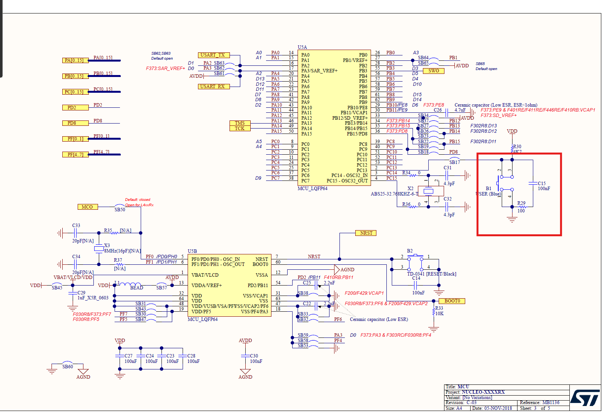

# LAB: GPIO Digital InOut


**Date:** 2026-09-22

**Author/Partner:** Yeonhu Kim

**Demo Video:** Youtube link

## Introduction

In this lab, you are required to create a simple program that toggles multiple LEDs using a push-button input.

You must create your own drivers for GPIO digital input and output control.

You must submit

* LAB Report (\*.pdf)
* Zip source files(\*main\*.c, ecRCC.h, ecGPIO.h etc...).
  * Only the source files.
  * Do not submit project files

### Requirement

#### Hardware

* MCU
  * NUCLEO-F411RE
* Eval Board
* Actuator/Sensor/Others:

#### Software

* PlatformIO, CMSIS, EC\_HAL library

***

## Problem 0: STM-Arduino

We are going to create a simple program that turns LED(LD2) on and off by pressing the user button(BT1), using Arduino Syntax

### GPIO Digital In/Out

Create a new project under the directory `\repos\EC\lab\`

* The project folder name is “**\LAB\_GPIO\_DIO\_LED”.**

Configures the specified pin to behave either as an input or an output.

```cpp
pinMode(pin, mode)
```

* pin: the pin number to set the model of.
* mode: INPUT, OUTPUT or INPUT\_PULLUP.

> Look up for pinMode() function in arduino reference for detail description.

### Example code

Open *Arduino IDE* and Create a new program named as ‘**TU\_arduino\_GPIO\_LED\_button.ino**’.

Write the following source code: [source code](https://github.com/ykkimhgu/EC-student/tree/main/stm32duino-tutorial).

```cpp
const int btnPin = 3;
const int ledPin = 13;

int btnState = HIGH;

void setup() {
  pinMode(ledPin, OUTPUT);
  pinMode(btnPin, INPUT);
}

void loop() {
  btnState = digitalRead(btnPin);

  if (btnState == HIGH) 
    digitalWrite(ledPin, LOW);
  
  else 
    digitalWrite(ledPin, HIGH);
  
}
```

The user button pin is `PC13`, but this pin cannot be used in arduino. So, you should connect `PC13` to `pinName` `D3` by using wire.


Click on **upload** button. Push the reset button(black) and check the performance.

The LED(LD2) should be turned on when the button is pressed.

***

## Problem 1: Create EC\_HAL library

### Procedure

#### **Prepare Library Files**

Manage your library in the directory of `\repos\EC\include\`.

> DO NOT make duplicates of library files under each project folders

* **For VS.Code User:** Save your header library files in this directory. [See here for detail.](/ec/ec-course/tutorial/tutorial-platformio-in-vscode.md)
* **For uVision User:** Save your header library files in this directory. [See here for detail.](https://ykkim.gitbook.io/ec/uvision/adding-my-api-header-in-uvision)

[Download library files.](https://github.com/ykkimhgu/EC-student/tree/main/include/lib-student)

* `ecRCC2.h, ecRCC2.c`
* `ecPinNames.h, ecPinNames.c`
* `ecGPIO2_student.h, ecGPIO2_student.c`

Create your own library for GPIO by renaming the downloaded files (`ecGPIO2_student.*)` as

* `ecGPIO2.c`, `ecGPIO2.h`
* Open `ecGPIO2.c` and change from `#include "ecGPIO2_student.h"` to `#include "ecGPIO2.h"`
* Write your name and modified date in the comment section

> You MUST write your name inside the comment section.

#### Function Definitions

Fill-in the blanks in the header files to complete the definitions for the provided functions

**ecGPIO2.h**

```cpp
void GPIO_init(PinName_t pinName, int mode);
void GPIO_write(PinName_t pinName, int Output);
int  GPIO_read(PinName_t pinName);
void GPIO_mode(PinName_t pinName, int mode);
void GPIO_ospeed(PinName_t pinName, int speed);
void GPIO_otype(PinName_t pinName, int type);
void GPIO_pupd(PinName_t pinName, int pupd);
```

* Example code in **ecGPIO2.c**

```cpp
// Input(00), Output(01), AlterFunc(10), Analog(11, reset)
void GPIO_mode(PinName_t pinName, uint32_t mode){
 	GPIO_TypeDef *port;
	unsigned int pin;
	ecPinmap(pinName, &port, &pin);
    
	port->MODER &= ~(3UL<<(2*pin));     
	port->MODER |= mode<<(2*pin);    
}
```

***

## Problem 2: Toggle a single LED with Digital Sensor(Photodetector)

### Problem

Toggle the LED by covering the photodetector sensor.

* Dark (LED ON), Bright (LED OFF) and repeat
* Connect the Photodetector sensor to PA\_0 pin on Nucleo Board.

### Procedure

1. Connect the evaluation board [(JKIT-NUCLEO) ](https://ykkim.gitbook.io/ec/ec-course/hardware/stm32f-evaluation-board#reference-manual)to the MCU.
2. Make sure that your library **ecGPIO2.h, ecGPIO2.c** are in `EC\include\`.
3. Create a new project under the directory `EC\lab\`

* Environment: “**LAB\_GPIO\_DIO\_LED\_Photosensor”.**
* Source File: “**LAB\_GPIO\_DIO\_LED\_Photosensor.c”**

4. You must modify the **`platformio.ini` ,** to add new environment.

### Configuration

Configure the MCU GPIO

| Function                  | Port - Pin | Configuration                                               |
| ------------------------- | ---------- | ----------------------------------------------------------- |
| **Photodetector on JKIT** | PA\_0      | Digital IN, Pull-Up                                         |
| **LED0**                  | PB\_12     | <p>Digital OUT, Pull-UP,</p><p>Open-Drain, Medium Speed</p> |

### Code

Explain your source code with necessary comments.


```c
#include "ecRCC2.h"
#include "ecGPIO2.h"

#define LED0 PB_12
#define PhotoSensor PA_0

// Initialiization 
void setup(void) {
	RCC_HSI_init();
	// initialize the photosensor pin as an input:
	GPIO_init(PhotoSensor, INPUT);  
	GPIO_pupd(PhotoSensor, 01);
	// initialize the LED pin as an output:
	GPIO_init(LED0, OUTPUT);
	GPIO_pupd(LED0, 01);
	GPIO_otype(LED0, 1);
	GPIO_ospeed(LED0, 01);
}
	
int main(void) { 
 	setup();
	int photoSensorState=0;
	
	while(1){
		// check if the photosensor is triggered. Turn LED on/off accordingly:
		photoSensorState = GPIO_read(PhotoSensor);
		if(photoSensorState)	GPIO_write(LED0, LOW);
		else 		GPIO_write(LED0, HIGH);
		delay_ms_HSI(100);             // delay 100 ms
	}
}
```
### Results

Experiment images and results


operation video link : https://youtube.com/shorts/qpnwia6t2WQ


## Problem 3: Toggle multiple LEDs with a button

### Problem

Use the four LEDs (LED0 to LED3) on the JKIT evaluation board.

Each time Button B1 is pressed, turn on one LED at a time in a sequential loop

* e.g., LED0 -> LED1 -> LED2 -> LED3 -> LED0

### Procedure

1. Connect the evaluation board [(JKIT-NUCLEO) ](https://ykkim.gitbook.io/ec/ec-course/hardware/stm32f-evaluation-board#reference-manual)to the MCU.
2. Make sure that your library **ecGPIO2.h, ecGPIO2.c** are in `EC\include\`.
3. Create a new project under the directory `EC\lab\`

* Environment: “**LAB\_GPIO\_DIO\_multiLED”**
* Source File: ““**LAB\_GPIO\_DIO\_multiLED.c”**

4. You must modify the **`platformio.ini` ,** to add new environment.

> You MUST write your name in the top of the source file, inside the comment section.

### Configuration

| Function           | Port - Pin                     | Configuration                                               |
| ------------------ | ------------------------------ | ----------------------------------------------------------- |
| **SW2 on JKIT**    | PA\_4                          | Digital IN, Pull-Up                                         |
| **LED\_0\~LED\_3** | PB\_12, PB\_13, PB\_14, PB\_15 | <p>Digital OUT, Pull-UP,</p><p>Open-Drain, Medium Speed</p> |


### Code

Your code goes here

Explain your source code with necessary comments.

```c
#include "ecRCC2.h"
#include "ecGPIO2.h"

#define LED0 PB_12
#define LED1 PB_13
#define LED2 PB_14
#define LED3 PB_15
#define SW2 PA_4

// Initialiization 
void setup(void) {
	RCC_HSI_init();
	// initialize the photosensor pin as an input:
	GPIO_init(SW2, INPUT);
	GPIO_pupd(SW2, 01);  
	// initialize the LED pin as an output:
	GPIO_init(LED0, OUTPUT);
	GPIO_pupd(LED0, 01);
	GPIO_otype(LED0, 1);
	GPIO_ospeed(LED0, 01);

	GPIO_init(LED1, OUTPUT);
	GPIO_pupd(LED1, 01);
	GPIO_otype(LED1, 1);
	GPIO_ospeed(LED1, 01);

	GPIO_init(LED2, OUTPUT);
	GPIO_pupd(LED2, 01);
	GPIO_otype(LED2, 1);
	GPIO_ospeed(LED2, 01);

	GPIO_init(LED3, OUTPUT);
	GPIO_pupd(LED3, 01);
	GPIO_otype(LED3, 1);
	GPIO_ospeed(LED3, 01);
}
	
int main(void) { 
 	setup();
	GPIO_write(LED0, HIGH);
	GPIO_write(LED1, LOW);
	GPIO_write(LED2, LOW);
	GPIO_write(LED3, LOW);
	
	while(1){
		if(GPIO_read(SW2) == LOW){
			// read the value of ODR(used GPIO_read_ODR function)
			if (GPIO_read_ODR(LED0) == HIGH){
				GPIO_write(LED0, LOW); 
				GPIO_write(LED1, HIGH);
			}
			else if (GPIO_read_ODR(LED1) == HIGH){
				GPIO_write(LED1, LOW); 
				GPIO_write(LED2, HIGH);
			}
			else if (GPIO_read_ODR(LED2) == HIGH){
				GPIO_write(LED2, LOW); 
				GPIO_write(LED3, HIGH);
			}
			else if (GPIO_read_ODR(LED3) == HIGH){
				GPIO_write(LED3, LOW); 
				GPIO_write(LED0, HIGH);
			}
			delay_ms_HSI(100); 
		}		
	}
}
```

### Results

Experiment images and results


operation video link : https://youtube.com/shorts/8yupDKdj4Tk
### Discussion

1. Find out a typical solution for software debouncing and hardware debouncing.

> When pressing or releasing mechanical buttons, a bouncing effect may occur, causing the input signal to change multiple times over a short period due to contact vibration. Diving is a method to prevent duplicate inputs caused by such unstable signals.<br>
A common method of software debouncing is to wait for a certain period after a button's state change is detected and then confirm the input again. For example, if the same state is maintained after 20 ms, it can be considered a valid input.<br>
At this time, the latency should be set according to the actual bouncy characteristics of the button. Alternatively, it can read input at regular intervals and recognize a state change only when multiple consecutive samples have the same value.<br>
A representative method of hardware dissimilation is the use of an RC low-pass filter composed of resistors and capacitors. It mitigates short and sudden voltage fluctuations by utilizing the charging and discharging characteristics of capacitors. Additionally, using a Schmitt trigger allows a ramping voltage to be converted into a stable digital signal.

2. What method of debouncing did this NUCLEO board use for the push-button(B1)?

<p align="center">

</p>

> Based on the NUCLEO-F411RE MB1136 C03 schematic, the user button B1 uses an RC filter composed of a resistor and a capacitor. The B1 circuit includes a pull-up resistor R30 (4.7 kΩ), a resistor R29 (100 Ω), and a capacitor C15 (100 nF). This circuit serves as a hardware debouncer to mitigate sudden voltage fluctuations caused by button contact bounce. However, depending on the actual duration of the bounce and the input processing conditions, software debouncing can be added.

## Reference

Complete list of all references used (github, blog, paper, etc)

```
https://ykkim.gitbook.io/ec/ec-course/lab/lab-gpio-digital-inout-eval

RM0383
Reference manual

NUCLEO-F411RE MB1136 C03 schematic
```

## Troubleshooting

In Problem 3, the program was written to sequentially switch from LED0 to LED3 by checking the previously set LED output values. At first, I tried using the existing GPIO_read() function, but upon examining its internals, I found that it reads the input data register (IRD) of the corresponding pin using the operation `(Port->IRD >> pin) & 1`.

IDR represents the actual logic level detected at the pin, while ODR represents the output control value the program last recorded. Although IDR can be read in output mode, it was determined that reading ODR is more suitable for this program because the required information is the previously set output value. In particular, in Open-Drain mode, setting the ODR to 1 puts the pin in a high-impedance state, and since the actual logic level of the pin is affected by pull-up and external circuits, it cannot be guaranteed that the IDR and ODR values are always equal.

Reflecting this, a separate GPIO_read_ODR() function was implemented. After obtaining the port and pin number using ecPinmap(), the output configuration of the corresponding pin is extracted using the operation `(Port->ODR >> pin) & 1U`. Button inputs are checked using the existing GPIO_read(), while the output settings are verified with GPIO_read_ODR() to determine the LED sequence.

Through this process, I understood that the appropriate register should be used to distinguish between checking the actual state of a GPIO pin and verifying the output values recorded by a program.
